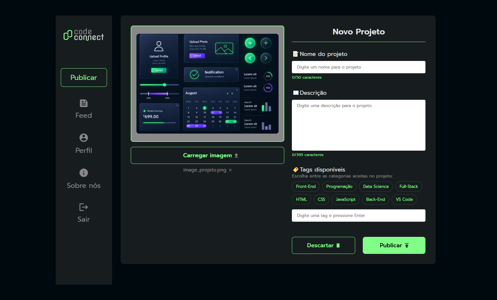

# 📑 CodeConnect  

O CodeConnect é uma aplicação web desenvolvida como parte de um projeto prático voltado à criação de uma plataforma de portfólio para o compartilhamento de projetos de programação. Seu objetivo é permitir que desenvolvedores apresentem seus trabalhos de maneira organizada, adicionando imagens, títulos, descrições e tags relacionadas às tecnologias utilizadas. A aplicação também conta com recursos para gerenciar o preenchimento do formulário e simular a publicação dos projetos.

   

### ⚙ Tecnologias Utilizadas

  
  
  

### ✔️ Funcionalidades

- **🖼️ Carregamento de imagens**: Permite selecionar uma imagem para representar o projeto que será apresentado.
- **📝 Preenchimento de informações**: Possibilita informar o nome e a descrição do projeto.
- **🏷️ Adição de tags**: Permite incluir categorias relacionadas às linguagens e tecnologias utilizadas no desenvolvimento.
- **🔎 Validação de tags**: Verifica se as tags adicionadas correspondem às categorias aceitas pela aplicação.
- **🔢 Contagem de caracteres**: Exibe a quantidade de caracteres digitados nos campos de nome e descrição.
- **🗑️ Descarte de informações**: Permite limpar os dados preenchidos e recomeçar o cadastro do projeto.
- **🚀 Simulação de publicação**: Oferece uma interação para publicar o projeto ou descartar as informações inseridas, com feedbacks visuais.
- **📱 Design responsivo**: Adapta os elementos da interface para diferentes tamanhos de tela, facilitando o uso em computadores e dispositivos móveis.

### 🌐 Como Acessar ?

1. Clone este repositório para sua máquina local.
2. Abra o arquivo index.html em seu navegador.
3. Ou, [Clique aqui](https://codeconnect-six.vercel.app).
4. Explore o CodeConnect e teste suas funcionalidades!